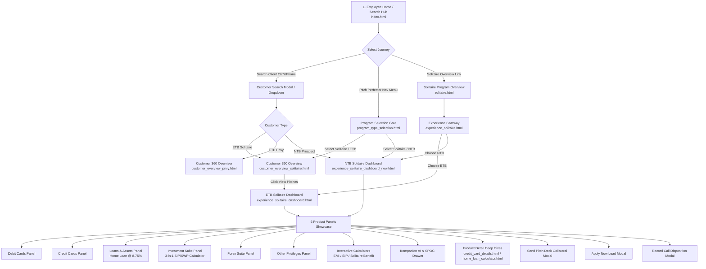

# 📘 Pitch Perfector Portal — Context & Complete User Flow Documentation

This document serves as the **authoritative master guide** for the **Pitch Perfector Portal** (Cloud Bank Employee & Relationship Manager Sales Suite). It covers the comprehensive business context, customer relationship tiers, architecture, complete user navigation flows, interactive feature specs, and page-by-page mapping.

---

## 📑 Table of Contents

1. [Executive Summary & Core Objective](#-executive-summary--core-objective)
2. [Business Context & Relationship Programs](#-business-context--relationship-programs)
3. [Customer Journeys & User Types](#-customer-journeys--user-types)
4. [Master End-to-End User Flow Diagram](#-master-end-to-end-user-flow-diagram)
5. [Step-by-Step Interactive Flow Breakdown](#-step-by-step-interactive-flow-breakdown)
6. [Complete Page-by-Page Reference Catalog](#-complete-page-by-page-reference-catalog)
7. [Dashboard Panels & Interactive Tools Spec](#-dashboard-panels--interactive-tools-spec)
8. [Modals, Drawers & AI Assistants](#-modals-drawers--ai-assistants)
9. [Technical State Management & Routing Rules](#-technical-state-management--routing-rules)

---

## 🎯 Executive Summary & Core Objective

The **Pitch Perfector Portal** is a high-performance sales, discovery, and client engagement web application designed for **Cloud Bank** Relationship Managers (RMs), Branch Officers, and Sales Executives. 

### Core Purpose
* **Pitch Acceleration:** Enables RMs to quickly search, pitch, compare, and cross-sell banking products across Wealth, Assets, Cards, and Investments during client meetings.
* **Tier-Tailored Experiences:** Dynamically presents relationship benefits customized for **Privy**, **Privy Plus**, and **Solitaire** wealth segments.
* **Interactive Financial Tools:** Empowers RMs with real-time financial calculators (SIP/SWP growth projections, Home Loan EMI estimations, Solitaire Savings Calculators) and pitch decks.
* **Instant Disposition & Lead Creation:** Captures customer interaction outcomes, sends pitch collateral directly via SMS/WhatsApp/Email, and records product leads.

---

## 🏛️ Business Context & Relationship Programs

Cloud Bank offers distinct relationship tiers based on Total Relationship Value (TRV) and Net Monthly Inflow. The Pitch Perfector portal dynamically adjusts pitches and branding based on the target tier:

```
                          ┌──────────────────────────┐
                          │   CLOUD BANK PORTAL      │
                          └────────────┬─────────────┘
                                       │
            ┌──────────────────────────┼──────────────────────────┐
            ▼                          ▼                          ▼
   ┌──────────────────┐       ┌──────────────────┐       ┌──────────────────┐
   │    PRIVY TIER    │       │  PRIVY PLUS TIER │       │  SOLITAIRE TIER  │
   │  (TRV: ₹10L+)    │       │   (TRV: ₹25L+)   │       │   (TRV: ₹75L+)   │
   └──────────────────┘       └──────────────────┘       └──────────────────┘
```

### 1. Solitaire Program (Ultra High Net Worth / Premium Tier)
* **Target Audience:** Premium HNI / UHNI clients (TRV ₹75L+ or Salary Inflow ₹5L+/month).
* **Signature Products:** Kotak Solitaire Metal Credit Card, Zero AMC Investments, 8.75% Home Loans, Zero Cross-Currency Forex, Dedicated SPOC / RM, Luxury Concierge.
* **Theme & Styling:** Regal Deep Wine / Dark Metallic Red (`#1e293b` & `#d61f26` / `#814D4B` gradients).

### 2. Privy Plus Program (High Net Worth Tier)
* **Target Audience:** High Net Worth Individuals (TRV ₹25L+ or Salary Inflow ₹2L+/month).
* **Signature Products:** Privy Plus Debit Card, Priority Banking Services, Reduced Forex Markups, Tailored Wealth Solutions.

### 3. Privy Program (Emerging HNI Tier)
* **Target Audience:** Emerging HNI / Mass Affluent clients (TRV ₹10L+ or Salary Inflow ₹1L+/month).
* **Signature Products:** Privy Everyday Banking, Standard Wealth Suite, Cashback Cards.

---

## 👥 Customer Journeys & User Types

The portal accommodates two core customer engagement states across **Individual** and **Business** segments:

```
                               ┌─────────────────────────┐
                               │ CLIENT ENGAGEMENT PATH  │
                               └────────────┬────────────┘
                                            │
                     ┌──────────────────────┴──────────────────────┐
                     ▼                                             ▼
       ┌───────────────────────────┐                 ┌───────────────────────────┐
       │   EXISTING TO BANK (ETB)  │                 │    NEW TO BANK (NTB)      │
       │   - Identified by CRN     │                 │    - Prospect / New Lead  │
       │   - 360° Profile Loaded   │                 │    - Instant Pitching     │
       │   - Tailored Upgrade Pitch│                 │    - Onboarding Pitch     │
       └───────────────────────────┘                 └───────────────────────────┘
```

1. **Existing To Bank (ETB):**
   * Identified via CRN, Mobile Number, or PAN lookup.
   * Loads full client profile, current account balances, existing cards, active loans, and holding relationship.
   * Focuses on **Upgrades**, **Cross-selling Assets & Investments**, and **Solitaire Experience Expansion**.

2. **New To Bank (NTB):**
   * Initiated for new prospects during fresh lead acquisition.
   * Provides frictionless access to full product showcase, feature comparison matrices, and instant rate calculators without requiring an active CRN.

---

## 🗺️ Master End-to-End User Flow Diagram



---

## ⏱️ Step-by-Step Interactive Flow Breakdown

### Flow 1: Client Search & Quick Pitch (Primary RM Flow)
1. **Entry:** RM opens `index.html` (Employee Portal Home).
2. **Search:** RM types CRN, Name, or Mobile Number into the top search bar.
3. **Profile Lookup:** Floating dropdown displays matching client results (e.g., Ashish Kumar, CRN 987654321).
4. **Customer Overview:** Clicking the profile navigates to `customer_overview_solitaire.html`.
5. **360° Inspection:** RM views client balance (e.g., ₹85.4L), active cards, investment holdings, and Solitaire status.
6. **Launch Experience:** RM clicks `✨ View Pitches` or `Explore Solitaire Privileges ↗`, launching the interactive dashboard (`experience_solitaire_dashboard.html`).

### Flow 2: Structured Program & Segment Selection
1. **Entry:** RM selects **Pitch Perfector > Solitaire** from sidebar navigation.
2. **Gate Page:** Portal loads `program_type_selection.html?program=solitaire`.
3. **Customer Segment Choice:** RM toggles between **Existing Customer (ETB)** and **New to Bank (NTB)**.
4. **Data Input:**
   * If **ETB:** Inputs CRN/Mobile, validates dummy profile, clicks **Proceed to Dashboard**.
   * If **NTB:** Inputs Prospect Name, Phone, Email, clicks **Proceed to Pitch Suite**.
5. **Dashboard Arrival:** 
   * ETB opens `experience_solitaire_dashboard.html`.
   * NTB opens `experience_solitaire_dashboard_new.html`.

### Flow 3: Interactive Presentation & Pitching
1. **Segment Toggle:** RM switches between **Individual** and **Business** segment tabs.
2. **Panel Navigation:** RM navigates across 6 dedicated tabs:
   * **Debit Card:** Highlight Zero Cross-Border fees and Free Unlimited Airport Lounge Access.
   * **Credit Card:** Expand comparison grid showing **Kotak Solitaire Metal Credit Card** vs Signature cards.
   * **Loans & Assets:** Showcase **Featured Home Loan @ 8.75% p.a.**, Loan Against Property (LAP), and Loan Against Securities.
   * **Investment Suite:** Slide the interactive SIP/SWP calculator to demonstrate 10-year wealth projections with year-by-year SVG bar chart visualization.
   * **Forex Suite:** Pitch zero markup forex cards for overseas travel or education.
   * **Other Privileges:** Highlight dedicated RM, priority branch desk, and complimentary locker facilities.

### Flow 4: Pitch Completion & Lead Conversion
1. **AI Assistance:** RM opens **Kompanion AI** sidebar to fetch objection-handling scripts or product comparison summaries.
2. **Send Collateral:** RM clicks **Send Deck / Share Pitch**, opening modal to dispatch customized PDF collateral via WhatsApp/SMS to the client.
3. **Apply / Capture Interest:** RM clicks **Apply Now** on a recommended product (e.g., Home Loan), populating client details in the application modal.
4. **Record Disposition:** RM logs meeting feedback via **Record Disposition Modal** (Options: *Interested*, *Follow-up Scheduled*, *Deck Sent*, *Declined*).

---

## 📑 Complete Page-by-Page Reference Catalog

Below is the complete inventory of all HTML pages within the workspace directory:

| Page File Name | Display Title & Section | Primary Target Audience | Key Features & Included Components |
| :--- | :--- | :--- | :--- |
| [`index.html`](file:///c:/Users/vaibh/Desktop/Pitch%20Perfector%20-%20Copy%20%283%29/index.html) | Home Page | Employee / RM Portal Entry | Global client search, recent client list, quick task launcher, program cards |
| [`program_type_selection.html`](file:///c:/Users/vaibh/Desktop/Pitch%20Perfector%20-%20Copy%20%283%29/program_type_selection.html) | Program Selection Gate | RM / Sales Officer | Segment selector (ETB vs NTB), CRN search, prospect form, program switcher |
| [`solitaire.html`](file:///c:/Users/vaibh/Desktop/Pitch%20Perfector%20-%20Copy%20%283%29/solitaire.html) | Solitaire Overview | Premium Prospects | Overall Solitaire wealth program benefits, eligibility criteria, tier highlights |
| [`solitaire_cc.html`](file:///c:/Users/vaibh/Desktop/Pitch%20Perfector%20-%20Copy%20%283%29/solitaire_cc.html) | Solitaire Credit Card Pitch | Card Prospects | Solitaire Metal Card showcase, lounge access, 5X rewards rate, golf privileges |
| [`solitaire_dc.html`](file:///c:/Users/vaibh/Desktop/Pitch%20Perfector%20-%20Copy%20%283%29/solitaire_dc.html) | Solitaire Debit Card Pitch | Debit Card Seekers | Premium Debit Card benefits, zero ATM charges, cashback tiers |
| [`experience_solitaire.html`](file:///c:/Users/vaibh/Desktop/Pitch%20Perfector%20-%20Copy%20%283%29/experience_solitaire.html) | Solitaire Experience Hub | Gateway Page | Selection card hub to jump to ETB Dashboard or NTB Dashboard |
| [`experience_solitaire_dashboard.html`](file:///c:/Users/vaibh/Desktop/Pitch%20Perfector%20-%20Copy%20%283%29/experience_solitaire_dashboard.html) | Solitaire ETB Dashboard | Existing Clients (ETB) | 6-Panel interactive dashboard with ETB comparison boxes, rate tables, and calculators |
| [`experience_solitaire_dashboard_new.html`](file:///c:/Users/vaibh/Desktop/Pitch%20Perfector%20-%20Copy%20%283%29/experience_solitaire_dashboard_new.html) | Solitaire NTB Dashboard | New Prospects (NTB) | Full 6-Panel interactive dashboard optimized for onboarding new prospects |
| [`experience_privy_dashboard.html`](file:///c:/Users/vaibh/Desktop/Pitch%20Perfector%20-%20Copy%20%283%29/experience_privy_dashboard.html) | Privy ETB Dashboard | Privy ETB Clients | Privy-specific product panels, cards, and investment features |
| [`experience_privy_dashboard_new.html`](file:///c:/Users/vaibh/Desktop/Pitch%20Perfector%20-%20Copy%20%283%29/experience_privy_dashboard_new.html) | Privy NTB Dashboard | Privy Prospects | Privy prospect presentation dashboard |
| [`experience_privy_plus_dashboard.html`](file:///c:/Users/vaibh/Desktop/Pitch%20Perfector%20-%20Copy%20%283%29/experience_privy_plus_dashboard.html) | Privy+ ETB Dashboard | Privy+ ETB Clients | Privy Plus specific dashboard panels |
| [`experience_privy_plus_dashboard_new.html`](file:///c:/Users/vaibh/Desktop/Pitch%20Perfector%20-%20Copy%20%283%29/experience_privy_plus_dashboard_new.html) | Privy+ NTB Dashboard | Privy+ Prospects | Privy Plus prospect presentation dashboard |
| [`customer_overview.html`](file:///c:/Users/vaibh/Desktop/Pitch%20Perfector%20-%20Copy%20%283%29/customer_overview.html) | General Customer 360 | Standard ETB Clients | Client overview, balance summary, active products, recent transactions |
| [`customer_overview_privy.html`](file:///c:/Users/vaibh/Desktop/Pitch%20Perfector%20-%20Copy%20%283%29/customer_overview_privy.html) | Privy Customer 360 | Privy ETB Clients | Privy client 360 view with Privy upgrade banners and direct pitch links |
| [`customer_overview_solitaire.html`](file:///c:/Users/vaibh/Desktop/Pitch%20Perfector%20-%20Copy%20%283%29/customer_overview_solitaire.html) | Solitaire Customer 360 | Solitaire ETB Clients | Premium 360 profile, Solitaire badge, quick pitch buttons, financial metrics |
| [`account_details.html`](file:///c:/Users/vaibh/Desktop/Pitch%20Perfector%20-%20Copy%20%283%29/account_details.html) | Savings Account Details | Account Holders | Balance breakdown, account interest rates, debit card linkage, quick transfers |
| [`account_more_details.html`](file:///c:/Users/vaibh/Desktop/Pitch%20Perfector%20-%20Copy%20%283%29/account_more_details.html) | Extended Account Details | Account Holders | Statement downloads, nominee details, branch SPOC, sweep-in facility |
| [`credit_card_details.html`](file:///c:/Users/vaibh/Desktop/Pitch%20Perfector%20-%20Copy%20%283%29/credit_card_details.html) | Credit Card Deep-Dive | Card Prospects | Detailed card specs, fee waivers, reward structure, fee comparison grid |
| [`debit_card_details.html`](file:///c:/Users/vaibh/Desktop/Pitch%20Perfector%20-%20Copy%20%283%29/debit_card_details.html) | Debit Card Deep-Dive | Card Prospects | ATM limits, international usage, cashback calculator, card controls |
| [`home_loan_calculator.html`](file:///c:/Users/vaibh/Desktop/Pitch%20Perfector%20-%20Copy%20%283%29/home_loan_calculator.html) | Home Loan Suite & Calc | Loan Borrowers | Interactive Home Loan EMI calculator, 8.75% rate breakdown, document list |
| [`loan_against_property.html`](file:///c:/Users/vaibh/Desktop/Pitch%20Perfector%20-%20Copy%20%283%29/loan_against_property.html) | Loan Against Property | Property Owners | LAP interest rates, eligibility criteria, LTV ratios, loan calculator |
| [`linked_deposits.html`](file:///c:/Users/vaibh/Desktop/Pitch%20Perfector%20-%20Copy%20%283%29/linked_deposits.html) | Linked Deposits (FD/RD) | Deposit Holders | Sweep-in FD benefits, interest rates (up to 7.75%), tenure options |
| [`calculate_benefit.html`](file:///c:/Users/vaibh/Desktop/Pitch%20Perfector%20-%20Copy%20%283%29/calculate_benefit.html) | Solitaire Savings Calculator | Prospects / RMs | Full-screen interactive tool calculating total annual savings across all products |
| [`service_requests.html`](file:///c:/Users/vaibh/Desktop/Pitch%20Perfector%20-%20Copy%20%283%29/service_requests.html) | Service Requests | Active Customers | Cheque book request, address update, card blocking, SR tracking table |
| [`transactions.html`](file:///c:/Users/vaibh/Desktop/Pitch%20Perfector%20-%20Copy%20%283%29/transactions.html) | Transaction History | Active Customers | Filterable transaction logs, download statements, category spending analysis |
| [`reliability.html`](file:///c:/Users/vaibh/Desktop/Pitch%20Perfector%20-%20Copy%20%283%29/reliability.html) | System Reliability & SLAs | Compliance / Internal | Service SLAs, bank security protocols, uptime stats, customer protection |

---

## 📊 Dashboard Panels & Interactive Tools Spec

The **Solitaire Interactive Dashboards** (`experience_solitaire_dashboard.html` & `experience_solitaire_dashboard_new.html`) are divided into **6 Core Product Panels**:

```
┌─────────────────────────────────────────────────────────────────────────────┐
│                      SOLITAIRE DASHBOARD CONTROL PANEL                      │
├───────────────┬───────────────┬───────────────┬───────────────┬─────────────┤
│  1. DEBIT CARD│  2. CREDIT CARD│   3. LOANS    │4. INVESTMENTS │  5. FOREX   │
│     PANEL     │     PANEL     │  & ASSETS     │     SUITE     │    PANEL    │
└───────────────┴───────────────┴───────────────┴───────────────┴─────────────┘
```

### 1. Debit Cards Panel
* **Hero Highlight:** Kotak Solitaire Platinum Debit Card.
* **Key Features:** Zero cross-currency markup, complimentary lounge access (8 per year), high daily ATM limits (₹2.5L), zero ATM charges worldwide.

### 2. Credit Cards Panel
* **Hero Highlight:** Kotak Solitaire Metal Credit Card.
* **Comparison Matrix:** Side-by-side comparison of **Solitaire Metal** vs **Solitaire Signature**.
* **Key Features:** 5X reward points on dining & international, complimentary golf rounds (2/month), 24x7 luxury concierge, zero join fee for Solitaire TRV tier.

### 3. Loans & Assets Panel
* **Hero Product:** **Featured Home Loan @ 8.75% p.a.** (Zero processing fee for Solitaire, max 30-year tenure).
* **Additional Asset Cards:** Loan Against Property (LAP @ 9.25%), Loan Against Securities (LASP), Personal Loan, Auto Loan.
* **Interactive Tool:** Embedded EMI Calculator with Loan Amount, Rate of Interest, and Tenure sliders recalculating monthly EMI and total interest dynamically.

### 4. Investment Suite Panel
* **3-in-1 Investment Return Calculator:** Supports **SIP** (Systematic Investment Plan), **SWP** (Systematic Withdrawal Plan), and **Lumpsum** investments.
* **Dynamic Controls:** Monthly investment slider (₹5,000 to ₹5,000,000), expected annual return rate slider (5% to 25%), investment duration slider (1 to 30 years).
* **Visual Output:** Dynamic SVG year-by-year bar chart rendering invested capital vs accrued wealth growth. Zero AMC wealth management pitch.

### 5. Forex Suite Panel
* **Hero Product:** Kotak Global Multi-Currency Forex Card.
* **Key Features:** Zero cross-currency markup, support for 16 international currencies, emergency card replacement worldwide, special student & corporate travel rates.

### 6. Other Privileges Panel
* **Bespoke Services:** Complimentary locker facilities (up to 100% discount), dedicated Relationship Manager (SPOC), priority branch queue jumping, exclusive access to golf clinics and art gallery previews.

---

## 🤖 Modals, Drawers & AI Assistants

The dashboards feature integrated tools that boost sales efficiency during client interactions:

```
┌─────────────────────────────────────────────────────────────────────────────┐
│                            INTERACTIVE SALES SUITE                          │
├──────────────────────┬──────────────────────┬───────────────────────────────┤
│    KOMPANION AI      │      SPOC DRAWER     │       DISPOSITION MODAL       │
│  - Objection Scripts │  - Dedicated RM Contact│  - Record Meeting Feedback    │
│  - Feature Lookup    │  - Branch Lead Assign │  - Schedule Follow-up Calls   │
├──────────────────────┼──────────────────────┼───────────────────────────────┤
│   SEND DECK MODAL    │   APPLY NOW MODAL    │   SOLITAIRE SAVINGS CALC      │
│  - Share PDF Collateral│  - Instant Lead Capture│  - Annual Value Calculation  │
└──────────────────────┴──────────────────────┴───────────────────────────────┘
```

1. **Kompanion AI Assistant (`#kompanionDrawer`):**
   * Floating AI widget providing instant pitch answers, competitive advantage matrices, and customized pitch generation.
2. **SPOC / RM Contact Drawer (`#spocDrawer`):**
   * Displays details of the client's assigned Senior Relationship Manager, direct phone, email, and branch location.
3. **Record Call / Meeting Disposition Modal (`#dispositionModal`):**
   * Captures meeting outcomes (*Interested*, *Need Time*, *Shared Deck*, *Declined*) with notes and calendar follow-ups.
4. **Send Pitch Deck Modal (`#sendDeckModal`):**
   * Sends personalized product brochure links and custom calculation summaries directly to client mobile or email.
5. **Apply Now / Lead Modal (`#applyModal`):**
   * Pre-fills client CRN/Name to instantly submit a pre-approved loan or credit card application to Cloud Bank CRM.

---

## ⚙️ Technical State Management & Routing Rules

The application uses standard web technologies (Vanilla JavaScript + CSS) with deterministic state management via **URL Parameters** and **`localStorage`**:

### 1. Key LocalStorage State Keys
* `solitaire_customer_name`: Name of the active customer prospect.
* `solitaire_crn`: Customer Relationship Number (CRN).
* `customerType`: `'Existing'` (ETB) or `'New'` (NTB).
* `selectedProgram`: `'solitaire'`, `'privy'`, or `'privy_plus'`.
* `selectedSegment`: `'individual'` or `'business'`.

### 2. URL Parameters Contract
* `program_type_selection.html?program=solitaire` -> Pre-selects Solitaire branding.
* `program_type_selection.html?program=privy` -> Pre-selects Privy branding.
* `customer_overview_solitaire.html?crn=987654321` -> Loads profile for CRN 987654321.

### 3. Server Configuration & Local Hosting
* Static file HTTP server script ([`server.py`](file:///c:/Users/vaibh/Desktop/Pitch%20Perfector%20-%20Copy%20%283%29/server.py)) running on **Port 3001**.
* Features **automatic `.html` extension fallback** for clean URLs (e.g., `/solitaire` resolves to `/solitaire.html`).
* Enforces `Cache-Control: no-store` to guarantee real-time updates during demonstration.

---

*Documentation compiled for Cloud Bank Pitch Perfector Suite — Master Architecture & Flow Guide.*
